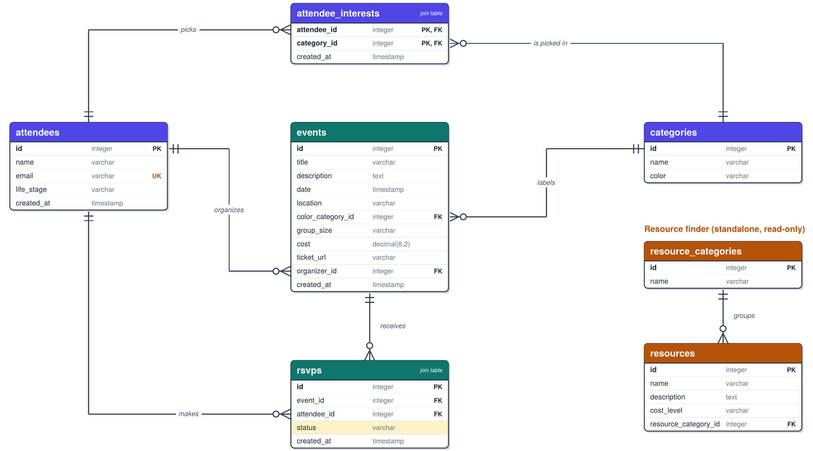

<!-- Reference the Creating an Entity Relationship Diagram final project guide in the course portal for more information about how to complete this deliverable. -->

## The List of Tables

1. `attendees`
2. `categories`
3. `attendee_interests` (join table)
4. `events`
5. `rsvps` (join table)
6. `resource_categories`
7. `resources`

## The Entity Relationship Diagram

<!-- [👉🏾👉🏾👉🏾 Include an image or images of the diagram below. You may also wish to use the following markdown syntax to outline each table, as per your preference.] -->

### Relationships

| Relationship                        | Type                                    | Description                                                                                                    |
| ----------------------------------- | --------------------------------------- | -------------------------------------------------------------------------------------------------------------- |
| `categories` → `events`             | one-to-many                             | A color category has many events. Each event has exactly one category.                                         |
| `attendees` → `events`              | one-to-many                             | An attendee organizes many events. Each event has exactly one organizer.                                       |
| `resource_categories` → `resources` | one-to-many                             | A resource category has many resources. Each resource belongs to one category.                                 |
| `events` ↔ `attendees`              | many-to-many (via `rsvps`)              | An event has many attendees, and an attendee can RSVP to many events. `status` is the unique join-table field. |
| `attendees` ↔ `categories`          | many-to-many (via `attendee_interests`) | An attendee picks many interest colors, and a color is picked by many attendees.                               |

### Table details

#### attendees

| Column Name | Type      | Description                                      |
| ----------- | --------- | ------------------------------------------------ |
| id          | integer   | primary key                                      |
| name        | varchar   | attendee's name                                  |
| email       | varchar   | attendee's email, unique                         |
| life_stage  | varchar   | new_to_town, recent_grad, student, or relocating |
| created_at  | timestamp | when the attendee was created                    |

#### categories

| Column Name | Type    | Description                                           |
| ----------- | ------- | ----------------------------------------------------- |
| id          | integer | primary key                                           |
| name        | varchar | interest name, such as Nature, Pets, or Entertainment |
| color       | varchar | hex color value, such as #2E8B57                      |

#### attendee_interests (join table)

| Column Name | Type      | Description                                             |
| ----------- | --------- | ------------------------------------------------------- |
| attendee_id | integer   | primary key (composite), foreign key to `attendees.id`  |
| category_id | integer   | primary key (composite), foreign key to `categories.id` |
| created_at  | timestamp | when the interest was picked                            |

#### events

| Column Name       | Type         | Description                                    |
| ----------------- | ------------ | ---------------------------------------------- |
| id                | integer      | primary key                                    |
| title             | varchar      | name of the event                              |
| description       | text         | details about the event                        |
| date              | timestamp    | when the event happens, must be in the future  |
| location          | varchar      | where the event happens                        |
| color_category_id | integer      | foreign key to `categories.id`                 |
| group_size        | varchar      | one_on_one, small, or large                    |
| cost              | decimal(8,2) | price of the event, 0 means free, must be >= 0 |
| ticket_url        | varchar      | optional link where tickets are sold           |
| organizer_id      | integer      | foreign key to `attendees.id`                  |
| created_at        | timestamp    | when the event was created                     |

#### rsvps (join table)

| Column Name | Type      | Description                   |
| ----------- | --------- | ----------------------------- |
| id          | integer   | primary key                   |
| event_id    | integer   | foreign key to `events.id`    |
| attendee_id | integer   | foreign key to `attendees.id` |
| status      | varchar   | going, maybe, or not_going    |
| created_at  | timestamp | when the RSVP was created     |

`(event_id, attendee_id)` is unique, so RSVPing again updates the status instead of creating a duplicate.

#### resource_categories

| Column Name | Type    | Description                                              |
| ----------- | ------- | -------------------------------------------------------- |
| id          | integer | primary key                                              |
| name        | varchar | Student Housing, Jobs, Study Spots, or Recovery Programs |

#### resources

| Column Name          | Type    | Description                             |
| -------------------- | ------- | --------------------------------------- |
| id                   | integer | primary key                             |
| name                 | varchar | name of the resource                    |
| description          | text    | details about the resource              |
| cost_level           | varchar | free, low, medium, or high              |
| resource_category_id | integer | foreign key to `resource_categories.id` |
